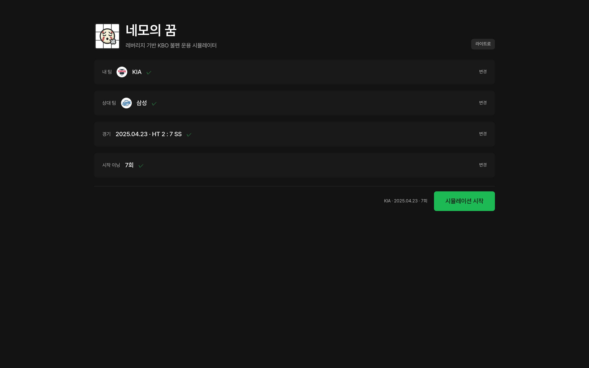
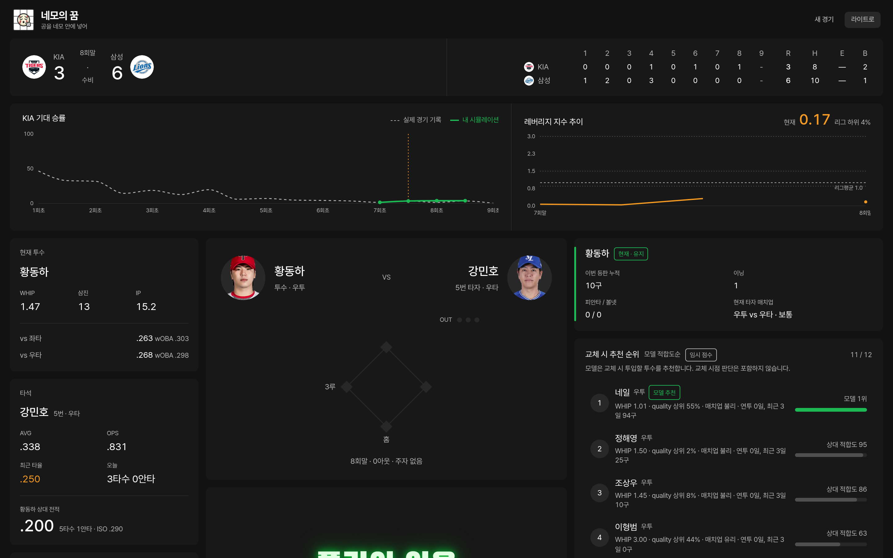
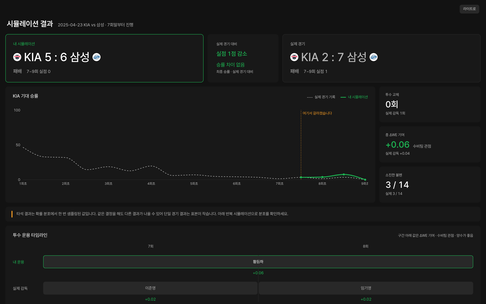
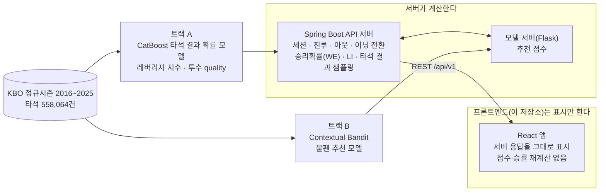

<p align="center">
  
</p>

<h1 align="center">네모의 꿈</h1>

<p align="center">
  레버리지 기반 KBO 불펜 운용 시뮬레이터<br />
  <a href="https://www.nemosdream.cloud">https://www.nemosdream.cloud</a> <!-- TODO: 도메인 연결 확인 -->
</p>

## 소개

네모의 꿈은 KBO 2025 시즌의 실제 경기로 돌아가 불펜 투수 교체를 직접 결정해 보는 시뮬레이터다.
사용자는 내 팀을 고르고 5~9회 중 시작 이닝을 정한 뒤, 수비 반이닝마다 투수를 유지할지 교체할지 선택한다.
교체 후보는 Contextual Bandit 모델의 점수 순으로 보여 준다. 선택 이후의 타석 결과는 서버가 계산한다.
경기가 끝나면 내 운용과 실제 감독의 운용을 비교하고, 같은 선택을 100번 반복한 결과의 분포를 확인한다.

홍익대학교 컴퓨터공학과 2026 졸업프로젝트 경기 상황 기반 KBO 투수 교체 추천 시스템 프론트엔드 저장소다.

## 동기

투수 교체는 경기 승패를 가르는 핵심 의사결정이다.
KBO 현장에서는 이 결정이 여전히 감독의 직관과 경험에 크게 의존한다.
10년 치 타석 데이터가 쌓여 있지만, 그것을 "지금 이 상황에서 누구를 올릴 것인가"라는 질문에 연결하는 도구는 없다.

**그래서 실제 경기의 승부처로 돌아가 "그때 다른 투수였다면?"을 직접 결정하고, 결과를 확인해 보는 시뮬레이터를 만들었다.**

## 컨셉

**이름의 의미.** "네모"는 스트라이크 존이다. 투수가 공을 존 안에 넣고 싶어 하는 마음과, 결정적인 순간에 그 공을 던질 투수를 고르는 감독의 고민을 함께 담았다. 서비스명은 "네모의 꿈 : 공을 네모 안에 넣어"다.

**플레이 방식**

1. 2025 시즌 실제 경기를 고르고, 내 팀과 시작 이닝(5~9회)을 정한다.
2. 내 팀이 수비하는 반이닝에서 사용자가 감독이 된다. 매 타석 현재 투수를 유지할지, 불펜에서 누구를 올릴지 결정한다.
3. 실제 감독과 같은 선택을 하는 동안은 실제 기록이 재생된다. 다른 투수를 고르는 순간부터 경기가 갈라지고, 이후 타석 결과는 확률 모델로 시뮬레이션된다.
4. 내 팀 공격 반이닝은 서버가 자동으로 진행한다.
5. 경기가 끝나면 결과 화면에서 내 운용과 실제 감독의 운용을 비교하고, 같은 선택으로 100번 다시 돌렸을 때의 분포를 확인한다.

**화면 흐름.** 온보딩(`/`) → 대시보드(`/game`) → 결과(`/result/:sessionId`)

## 주요 기능

- **교체 시 추천 순위**: Contextual Bandit 모델 점수 순으로 후보를 보여 준다. 모델 1위를 자동 선택하지 않고, 사용자가 직접 고른다.
- **레버리지 지수(Leverage Index, LI)**: 지금 상황이 얼마나 중요한지를 리그 백분위와 함께 표시한다.
- **기대 승률 곡선**: 실제 경기 기록과 내 시뮬레이션을 겹쳐 그리고, 경기가 갈라진 지점을 표시한다.
- **타석 결과 확률 분포**: 9가지 결과(1루타~병살타)의 확률과 실제로 나온 결과를 보여 준다.
- **되돌리기**: 타석 단위로 되돌린다. 같은 선택을 다시 하면 같은 결과가 나온다(시드 고정).
- **결과 화면**: 점수, 내준 점수, 최종 승률 비교, 투수 운용 타임라인, 결정 비교 테이블, 같은 선택으로 100회 반복 시뮬레이션을 보여 준다.

## 스크린샷

**온보딩** — 팀, 경기, 시작 이닝을 고른다.



**대시보드** — 실제 감독과 다른 투수를 고른 이후. 승률 곡선에 갈라진 지점이 표시되고, 교체 후보가 모델 점수 순으로 나온다.



**결과** — 내 시뮬레이션과 실제 경기의 점수, 승률 곡선을 비교한다.



## 시스템 구성



| 트랙 | 담당          | 역할                                                           |
| ---- | ------------- | -------------------------------------------------------------- |
| A    | 변희민        | CatBoost 타석 결과 확률 모델, 레버리지 지수, 투수 quality 지표 |
| B    | 윤서현        | Contextual Bandit 불펜 추천 모델, 평가 하네스                  |
| C    | 박규영 (팀장) | 프론트엔드, UI/UX 디자인, 백엔드 요구사항 명세                 |

- 백엔드: Spring Boot API 서버 + 모델 서버(Flask) 
- 데이터: KBO 정규시즌 2016~2025, 타석 558,064건(`all_pa_enriched_v3`)
- 레버리지 지수: 문형우·우용태·신양우(2016), "한국 프로야구 경기에서 기대득점과 기대승리확률의 계산", 응용통계연구 29(2)의 승리확률 테이블 기반
- 모델 저장소: [NextPitchh/KBO_Crawler](https://github.com/NextPitchh/KBO_Crawler) 

## 추천 모델과 그 범위

모델은 **"교체하기로 정했을 때, 지금 가용한 불펜 중 누구를 올릴 것인가"**만 학습했다.
현재 투수를 유지할지 말지는 학습 범위가 아니다. 그래서 현재 투수에는 점수를 표시하지 않고, 유지와 교체의 판단은 사용자가 한다.
점수는 투수 관점의 타석당 기대 승리확률 기여(WPA/PA)를 바탕으로 한 상대 점수다. 실제 승률 변화로 직접 해석하지 않는다.
이 범위를 화면에도 문장으로 적어 둔다("모델은 교체 시 투입할 투수를 추천합니다. 교체 시점 판단은 포함하지 않습니다.").
모델 성능 지표는 모델 저장소에서 다룬다.

**설계가 바뀐 과정**

- 초기 기획은 금융 포트폴리오 이론(평균-분산)을 투수 운용에 적용하고 DQN으로 순차 결정을 학습하는 방향이었다.
- 검증 결과 기대값 추정이 노이즈에 가까워 이 구조를 폐기했고, 상황 중요도(LI)와 투수 품질을 결합한 효용 함수도 근거를 방어하기 어려워 폐기했다.
- 최종적으로 교체 시점의 투수 선택 문제로 범위를 좁히고 Contextual Bandit을 채택했다.

## 기술 스택

| 영역       | 선택                       | 비고                                                                                             |
| ---------- | -------------------------- | ------------------------------------------------------------------------------------------------ |
| 빌드       | Vite 8                     | 개발 서버에서 API proxy 제공                                                                     |
| 프레임워크 | React 19                   |                                                                                                  |
| 언어       | TypeScript 6               | `tsc -b`가 빌드에 포함됨                                                                       |
| 라우팅     | React Router 7             | 3개 라우트                                                                                       |
| 스타일     | Tailwind CSS 3             | 커스텀 브레이크포인트 640 / 1024 / 1200 / 1440px                                                 |
| 컴포넌트   | shadcn/ui (new-york)       | Radix UI, class-variance-authority, lucide-react                                                 |
| 차트       | Recharts 3                 | 승률 곡선, 레버리지 추이, 히스토그램                                                             |
| 애니메이션 | Framer Motion 13           | 결과 이펙트·이닝 전환은 직접 작성한 CSS 애니메이션이며, 완료 시점은 Web Animations API로 읽는다 |
| 폰트       | Pretendard, Black Han Sans | 본문은 Pretendard, 결과·이닝 전환 이펙트는 Black Han Sans                                       |
| 테마       | tweakcn 프리셋             | oklch CSS 변수, 다크/라이트                                                                      |
| 린트       | oxlint                     |                                                                                                  |
| 검증       | Playwright, smoke 스크립트 | Playwright는 저장소 밖 스크립트로 실행(의존성 아님), smoke는 `scripts/smoke-api.ts`            |
| 배포       | Vercel                     |                                                                                                  |

## 프론트엔드 설계 결정

1. **게임 상태는 서버가 소유하고, 응답으로 통째로 교체한다.**
   진루·아웃·승리확률을 프론트에서 다시 구현하면 같은 규칙이 두 곳에 생긴다. 응답 `GameState`로 화면 상태를 교체하고 부분 갱신하지 않는다.
2. **백엔드 접근은 `@/api` 한 곳으로 모으고, 목업으로 바꿀 수 있다.**
   컴포넌트는 훅만 거친다. 서버 장애에 대비해 `VITE_USE_MOCK=true`로 같은 인터페이스의 목업을 쓸 수 있다(발표용 대비).
3. **서버 응답은 엔드포인트별로 명시 매핑한다.**
   범용 snake_case→camelCase 변환기를 쓰지 않았다. `R/H/E/B`, `L/R`, `1B` 같은 키는 필드명이 아니라 데이터라서 변환하면 깨진다.
4. **요청 중 액션을 잠그고, 늦게 온 응답은 무효화한다.**
   상태를 가진 서버에 중복 요청이 가면 타석이 두 번 진행될 수 있다. 진행 중에는 버튼을 잠그고, 순서가 뒤바뀐 재조회 응답은 버린다.
5. **레버리지 추이는 서버가 준 값을 기록만 한다.**
   응답마다 `leverage_index`를 쌓아 그리며 클라이언트에서 계산하지 않는다. 헤더의 현재 LI와 차트 마지막 점이 같은 값이 된다.
6. **폰트 크기는 모든 화면 폭에서 고정한다.**
   수치가 핵심인 화면이라 폭에 따라 글자 크기가 바뀌면 비교가 어려워진다. 폭에 따라서는 레이아웃만 바뀐다.

## 시작하기

Node.js 20.19 이상(Vite 8 요구)이 필요하다.

```bash
npm install
npm run dev          # 실서버 모드: http://localhost:5173
```

목업 모드(서버 없이 실행):

```bash
VITE_USE_MOCK=true npm run dev
```

| 환경 변수         | 개발(`.env.development`) | 운영(`.env.production`)    | 설명                            |
| ----------------- | -------------------------- | ---------------------------- | ------------------------------- |
| `VITE_API_BASE` | 빈 값 (Vite proxy 경유)    | `https://api.nemosdream.cloud` | API 서버 주소                   |
| `VITE_USE_MOCK` | `false`                  | 지정하지 않음(= 실서버)      | `true`면 `src/mocks`를 사용 |

- 개발 서버는 Vite proxy(`/api`, `/health`, `/static`)로 CORS를 우회한다. 서버가 `http://localhost:5173` Origin만 허용해서, proxy가 `Origin` 헤더를 제거한다.
- 배포할 때는 서버의 CORS 허용 목록에 배포 도메인을 추가해야 한다.

```bash
npm run build        # 타입 검사(tsc -b) + 프로덕션 빌드
npm run preview      # 빌드 결과 미리보기
npm run lint         # oxlint
npx tsx --tsconfig tsconfig.app.json scripts/smoke-api.ts --offline   # 어댑터를 기록된 샘플과 대조(서버 불필요)
npx tsx --tsconfig tsconfig.app.json scripts/smoke-api.ts             # 위 + 실서버에 시뮬레이션 세션 1개를 만들어 진행
```

테스트 러너는 없다. 변경 후에는 `npm run build`, `npm run lint`, smoke 스크립트로 확인한다.

## 디렉토리 구조

```text
src/
├── api/          백엔드 접근의 단일 경계: fetch 클라이언트, 엔드포인트, 어댑터(adapters/), 목업 연결, 세션 저장
├── components/   화면 컴포넌트
│   ├── common/       공용(팀 엠블럼, 선수 사진, 에러 배너)
│   ├── dashboard/    대시보드 카드(매치업, 후보 목록, 차트, 로그)
│   ├── game/         결과 이펙트, 이닝 전환·공격 반이닝 오버레이
│   ├── onboarding/   팀·경기·이닝 선택
│   ├── result/       결과 화면 카드, 타임라인, 비교 테이블
│   └── ui/           shadcn/ui 기본 컴포넌트
├── context/      세션 파라미터, 테마
├── hooks/        세션 진행, 히스토리(로그·LI), 팀·경기·설정 조회, 액션 잠금
├── lib/          표시용 유틸(결과·LI 문구, 에러 문구, 전환 타이밍)
├── mocks/        목업 서버(세션 엔진, 로스터, 일정). 목업 모드에서만 사용
├── pages/        라우트 3개: 온보딩, 대시보드, 결과
└── types/        API 응답 타입, 추천 타입, 히스토리 타입
```

그 밖: `public/`(로고, 구단 엠블럼), `scripts/`(smoke 스크립트), `docs/`(문서).

## 문서

- [`docs/API_연동명세_nemosdream.md`](docs/API_연동명세_nemosdream.md): 실서버 연동 명세. 호출 흐름, 타입, 에러 코드, 실측으로 확인한 명세와의 차이.
- [`docs/api-docs.json`](docs/api-docs.json): 백엔드 OpenAPI 3.1 원본.
- [`docs/api-recommendation.md`](docs/api-recommendation.md): 추천 데이터 인터페이스.
- [`docs/integration/REPORT.md`](docs/integration/REPORT.md): 연동 결과 보고. 완료 항목, 남은 이슈, 백엔드 요청 목록.
- [`docs/integration/`](docs/integration/): 연동 과정의 조사·계획·검증 기록과 실서버 응답 샘플.
- [`K-Moneyball 프론트엔드 → 백엔드 요구사항 명세( U 폐기 버젼).md`](<K-Moneyball 프론트엔드 → 백엔드 요구사항 명세( U 폐기 버젼).md>): 프론트가 백엔드 두 트랙에 전달한 초기 요구사항. 연동 명세와 충돌하면 연동 명세가 우선한다.

## 팀

| 이름   | 역할                            |
| ------ | ------------------------------- |
| 박규영 | 팀장, 트랙 C 프론트엔드·디자인 |
| 변희민 | 트랙 A                          |
| 윤서현 | 트랙 B                          |

## 데이터 출처와 고지

- 경기 기록: KBO 리그 공개 기록을 수집·가공했다(NextPitchh/KBO_Crawler).
- 선수 사진: 공개 프로필 이미지를 사전 수집해 자체 서버에서 제공한다.
- 구단 엠블럼과 명칭의 권리는 각 구단에 있으며, 이 프로젝트는 비상업적 교육 목적으로 사용한다.
